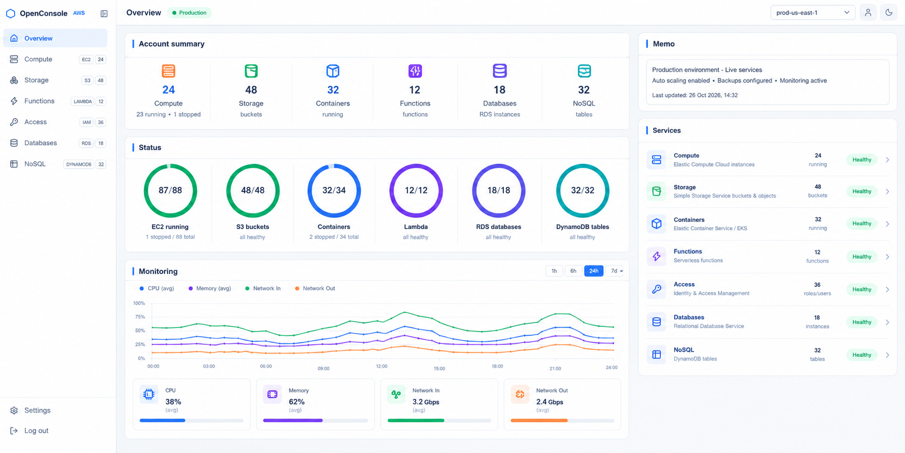

# AWS OpenConsole

### AWS for Homosapiens



Skip the command line. OpenConsole is a graphical console for the AWS services
you use every day — spin up servers, manage files, deploy functions and control
access, all from your browser.

---

## Features

### Six services, fully browsable

| Service | What you can do |
| --- | --- |
| **Compute** (EC2) | Launch, start, stop and terminate instances. From an instance's page: rename, resize, edit firewall rules, manage tags and volumes, take backups. |
| **Storage** (S3) | Browse buckets and folders, upload, download and move files. Versioning, encryption and static website hosting included. |
| **Functions** (Lambda) | Write functions as inline code, deploy updates, attach triggers and manage function URLs. |
| **Access** (IAM) | Manage users, roles, groups and policies, with dependency-aware deletes that clean up what depends on something. |
| **Databases** (RDS) | List, start and stop database instances. |
| **NoSQL** (DynamoDB) | Browse tables and items, manage GSIs, TTL and streams. |

### Built for real work

- **Guest mode** — no sign-up. Paste credentials and go. They stay in your
  browser and are never stored on the server.
- **Register mode** — create an account and save connection profiles. AWS
  secrets are encrypted at rest and are never sent back to your browser.
- **In-app terminal** — a real `aws` CLI that shares your region and
  credentials with the GUI.
- **Inspector** — every call is logged with the raw JSON response *and* the
  exact CLI command to reproduce it.
- **LocalStack ready** — point the endpoint at a local AWS emulator and build
  against free fake AWS.
- **History** — signed-in sessions sync your activity across devices; guests
  keep it in the browser.
- **Dark mode**, and a layout that works on phone and desktop.

---

## Prerequisites

| To… | You need |
| --- | --- |
| **Run it** | [uv](https://docs.astral.sh/uv/) — that's all. It installs Python for you if needed, and the UI ships compiled. |
| **Develop it** | Node.js 20.19+ (frontend dev server & rebuilding the UI), Python 3.13+, git |
| **Connect to AWS** | an account with access keys — *or* skip AWS entirely with LocalStack, below |

---

## Tech stack

**Frontend** — React 19, TypeScript, Vite, Tailwind CSS v4, shadcn/ui,
React Query, Zustand.

**Backend** — FastAPI, boto3 (and the real `aws` CLI for the terminal),
SQLAlchemy + Alembic on SQLite. Auth is JWT sessions with bcrypt password
hashing; stored AWS secrets are encrypted with Fernet.

Your browser never talks to AWS. It sends each query to the backend, which
signs and executes it — so there's no browser CORS problem, and in register
mode your credentials stay server-side.

---

## Common commands

### Run it — one command, no clone

```bash
uvx --from "git+https://github.com/0xAungkon/openconsole-aws" aws-openconsole
```

Then open **http://127.0.0.1:4567**.

That is the entire install: the compiled UI and the database migrations ship
inside the package, so there is nothing to clone, no `npm install`, and no
setup commands. The only requirement is [uv](https://docs.astral.sh/uv/).

Options: `--host 0.0.0.0` to reach it from your phone or another machine,
`--port 9000` to move it off 4567.

Once published to PyPI the command shortens to `uvx aws-openconsole`.

### Or run it with Docker

```bash
docker compose up -d
```

Then open **http://localhost:4567** — same port either way.

No Python or Node required: the image bundles the already-compiled UI, runs as
a non-root user, and keeps SQLite in a named volume so your data survives
rebuilds and `docker compose down`.

To be able to store AWS profiles in register mode, pass the two secrets (the
comments in `docker-compose.yml` show how to generate them):

```bash
JWT_SECRET=... ENCRYPTION_KEY=... docker compose up -d
```

### Configuration (optional)

It runs immediately with built-in defaults, but register mode can't store AWS
profiles until an encryption key exists. Set it as an environment variable:

```bash
export JWT_SECRET="$(openssl rand -hex 32)"
export ENCRYPTION_KEY="$(python3 -c 'from cryptography.fernet import Fernet; print(Fernet.generate_key().decode())')"
uvx --from "git+https://github.com/0xAungkon/openconsole-aws" aws-openconsole
```

If you did clone the repo, `cp .env.example .env` and edit that instead — the
app reads `./.env` from the directory you start it in.

### Develop

```bash
uv sync                              # Python dependencies
uv run aws-openconsole --reload      # API + UI on :4567; rebuilds the UI when sources change

cd frontend && npm install           # only needed for hot-reload UI work
npm run dev                          # http://localhost:5173, talks to :4567
npm run build                        # typecheck + rebuild the bundled UI
```

### Tests

```bash
uv run pytest
```

### Try it without an AWS account

Run [LocalStack](https://localstack.cloud/) locally, then choose **Guest**
mode with endpoint `http://localhost:4566` and the dummy credentials
`test` / `test`.

```bash
docker run -d --name localstack -p 4566:4566 localstack/localstack:3.0
```

---

## License

Released under the [Creative Commons Attribution-NonCommercial 4.0](LICENSE)
International license.

You are free to use, modify and share this for **personal, non-commercial**
purposes. Commercial use is **not** permitted without permission.

Copyright © 2026 [0xAungkon](https://github.com/0xAungkon).
